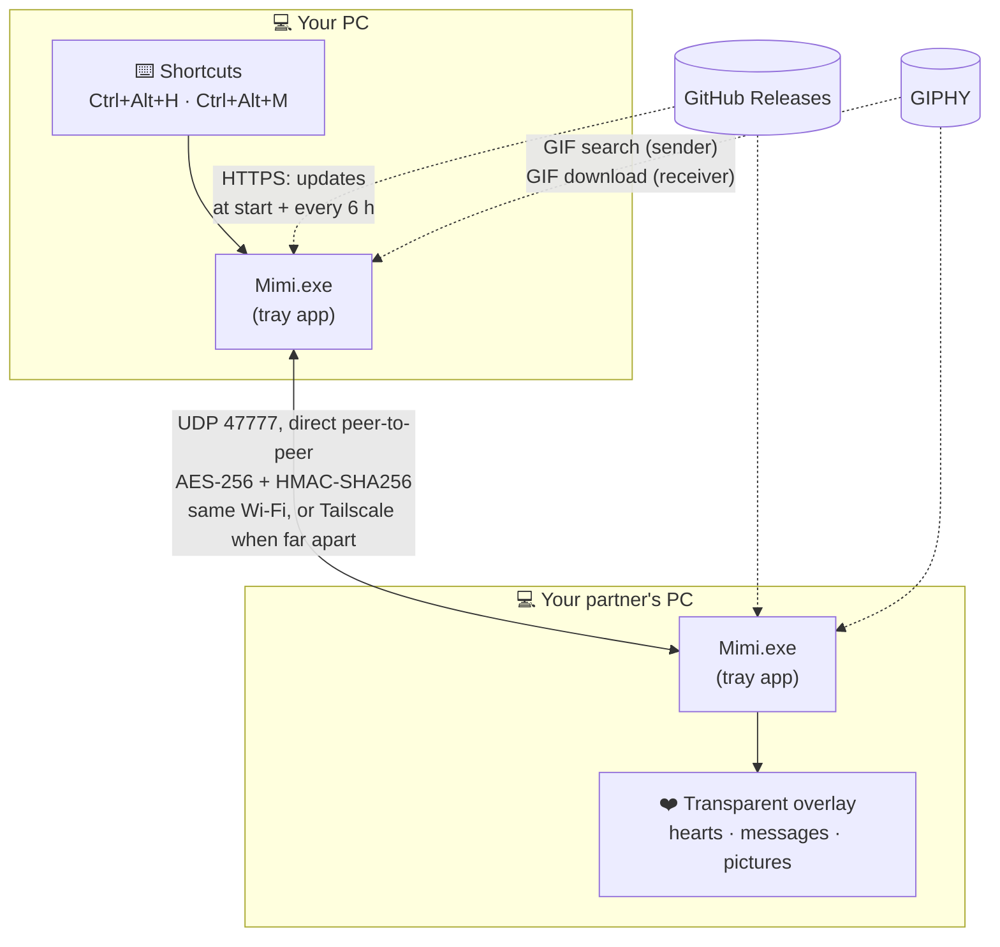
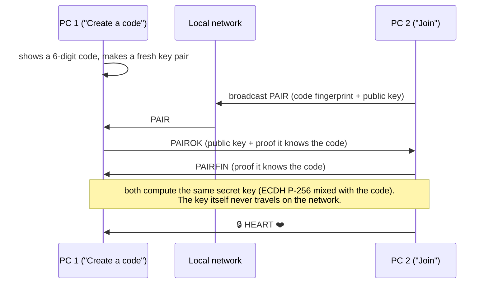
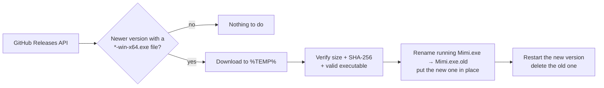

# Mimi 💗

**Send little hearts to your other half's screen with one key.**

<p align="center"></p>

<p align="center">
🌍
<a href="docs/readme/README.fr.md">Français</a> ·
<a href="docs/readme/README.es.md">Español</a> ·
<a href="docs/readme/README.pt.md">Português</a> ·
<a href="docs/readme/README.it.md">Italiano</a> ·
<a href="docs/readme/README.de.md">Deutsch</a> ·
<a href="docs/readme/README.nl.md">Nederlands</a> ·
<a href="docs/readme/README.pl.md">Polski</a> ·
<a href="docs/readme/README.sv.md">Svenska</a> ·
<a href="docs/readme/README.da.md">Dansk</a> ·
<a href="docs/readme/README.nb.md">Norsk</a> ·
<a href="docs/readme/README.fi.md">Suomi</a> ·
<a href="docs/readme/README.cs.md">Čeština</a> ·
<a href="docs/readme/README.sk.md">Slovenčina</a> ·
<a href="docs/readme/README.el.md">Ελληνικά</a> ·
<a href="docs/readme/README.hu.md">Magyar</a> ·
<a href="docs/readme/README.ro.md">Română</a> ·
<a href="docs/readme/README.bg.md">Български</a> ·
<a href="docs/readme/README.hr.md">Hrvatski</a> ·
<a href="docs/readme/README.uk.md">Українська</a> ·
<a href="docs/readme/README.ru.md">Русский</a> ·
<a href="docs/readme/README.tr.md">Türkçe</a> ·
<a href="docs/readme/README.ar.md">العربية</a> ·
<a href="docs/readme/README.he.md">עברית</a> ·
<a href="docs/readme/README.fa.md">فارسی</a> ·
<a href="docs/readme/README.hi.md">हिन्दी</a> ·
<a href="docs/readme/README.zh.md">中文</a> ·
<a href="docs/readme/README.ja.md">日本語</a> ·
<a href="docs/readme/README.ko.md">한국어</a> ·
<a href="docs/readme/README.vi.md">Tiếng Việt</a> ·
<a href="docs/readme/README.th.md">ไทย</a> ·
<a href="docs/readme/README.id.md">Bahasa Indonesia</a>
</p>

Mimi is a tiny free app for Windows, made for couples. Press a shortcut and small hearts float up in the corner
of your partner's screen, with a soft, cute sound. Hold it for a big heart, write a sweet message, send a picture or a GIF.

- 💗 **Hearts**: tap for a few, spam for a shower, hold for a big one that grows until you let go
- 💞 **Sync**: press at the same time as your partner for a surprise
- 💌 **Messages, pictures & GIFs**, shown in the middle of the screen
- 🎨 **Your colours**: 8 themes or your own colour, 3 styles; your partner sees your hearts in *your* colours
- 🌙 **Do not disturb** for 10 minutes to 24 hours, or until you turn it off
- 📊 **Cute stats**: today, streak, the last 7 days
- 🔒 **Private**: no account, no server, end-to-end encrypted
- 🪶 **Tiny & light**: one ~200 KB file, 0 % CPU at rest, never slows your games down
- 🔄 Starts with Windows and **updates itself**
- 🌍 **31 languages**

---

## 1. Install it (on both PCs)

1. **Download** `Mimi-…-win-x64.exe` from the [latest release](https://github.com/axel-gilbert/mimi/releases/latest).
2. **Double-click** the file.
   - If a blue window says *"Windows protected your PC"*, click **More info**, then **Run anyway**.
     (This appears only because Mimi is a small free app that isn't signed by a company.)
3. Mimi asks *"Install Mimi on this PC?"*: click **Yes**.
4. If Windows asks for permission (network, or *"Do you want to allow this app…"*), click **Yes / Allow**.
5. The Mimi window opens. Type **your name**.

Do the same on your partner's PC. ✅

> Mimi now lives near the clock (a small heart icon). Don't see it? Click the little **^** arrow next to the clock.

## 2. Connect the two PCs (only once)

Both PCs must be **at the same place, on the same Wi-Fi / internet box** for this step.

| On PC 1 | On PC 2 |
|---|---|
| Click **Create a code**. A 6-digit code appears. | Type that code, then click **Join**. |

Hearts rain on both screens: you're connected! 💞 From now on Mimi reconnects by itself.

## 3. Use it

| What | How |
|---|---|
| A few hearts | **Ctrl + Alt + H** |
| A shower of hearts | press it again and again |
| A big heart | **hold** Ctrl + Alt + H; it grows until you let go |
| A message, a picture or a GIF | **Ctrl + Alt + M**, type, **Enter**. **Photo**, **Ctrl + V** or drag & drop for a picture; **GIF** (or **Ctrl + G**) to pick a GIF |
| A surprise | press at the same time as your partner 💞 |
| Do not disturb | right-click the heart icon → **Do not disturb** |
| Colours, sound, shortcuts, language, stats | click the heart icon |

The heart icon is **pink** when your partner is connected, **grey** when not, **lilac** in do-not-disturb mode.

## Questions

**My partner doesn't receive anything.**
Check that their heart icon is pink. If it's grey, their PC is off, Mimi is closed, or you're not on the same network (see below).

**We don't live together / we're on different networks.**
Mimi connects the two PCs directly, so they need to "see" each other. The easiest free way:
1. Install [Tailscale](https://tailscale.com/download) on both PCs and sign in with the same account.
2. In Tailscale, note the address of the *other* PC (it looks like `100.x.y.z`).
3. In Mimi → **General** → **Advanced**, type that address on each PC and click **Save**.
4. Pair as usual: one PC creates a code, the other types it and clicks **Join**.

**I don't see hearts during a game.**
Hearts show above everything, but games in *exclusive full screen* hide them. Use *borderless window* mode in the game.

**I updated from 0.1 or 0.2. Do we need to pair again?**
No, your pairing keeps working. Pairing again (once both PCs have 0.3) gives you the strongest security.

**How do updates work?**
Mimi checks for a new version when it starts and every 6 hours, downloads it, checks it, installs it and restarts.
You can turn this off in **General**.

**How do I uninstall it?**
Right-click the heart icon → **Uninstall…**, or *Windows Settings → Apps*.

---

## How it works



- **No server of our own.** The two Mimi apps send each other small UDP messages: hearts, big hearts, syncs,
  messages, pictures (cut into small chunks, missing ones are asked again) and presence pings.
  GIFs only travel as a GIPHY id; each PC downloads the animation from GIPHY itself.
- **Private.** Every message is encrypted (AES-256-CBC) and authenticated (HMAC-SHA256) with the couple's key,
  and protected against replays (counter + timestamp). The key is stored encrypted for your Windows account (DPAPI).
- **Light.** The overlay window is hidden when nothing moves (0 % CPU). While hearts fly, a small home-made renderer
  only redraws the area that changes, and Mimi runs at low priority so your games always come first.

### Pairing



If an address changes later (router restarted…), a PC that can't reach its partner broadcasts an encrypted ping on the
local network and the partner answers: they find each other again automatically.

### Updates



---

## For developers

**Build** (needs the [.NET SDK](https://dotnet.microsoft.com/download) 8 or newer; the app targets .NET Framework 4.8, built into Windows 10/11):

```powershell
powershell -ExecutionPolicy Bypass -File build.ps1      # -> dist\Mimi.exe
dotnet test tests/Mimi.Tests/Mimi.Tests.csproj          # unit tests
```

**Release**: push a tag, GitHub Actions does the rest (tests, build with the tag's version, GIPHY key from the
`GIPHY_API_KEY` repository secret, release with the exe and its SHA-256). Release notes come from `docs/releases/vX.Y.Z.md`.

```powershell
git tag v0.3.0
git push origin v0.3.0
```

**Demo GIF**: `tools/make-demo-gif.ps1` renders `docs/demo.gif` off-screen (needs ffmpeg).

**Translations**: one file per language in `lang/` (`key=value`, embedded in the exe). Add a file and a line in
`src/Lang.cs` to add a language; missing keys fall back to English.

**Project layout**

| File | Role |
|---|---|
| `src/Program.cs` | Entry point, command-line options, single instance |
| `src/MimiApp.cs` | Tray icon, shortcuts (tap / hold), sync, do not disturb, stats, updates wired together |
| `src/Overlay.cs` | Transparent click-through window and all animations |
| `src/Blitter.cs` | Fixed-point software renderer + dirty-tile tracking |
| `src/Art.cs` | Hearts drawn in code, colour themes and styles |
| `src/PeerLink.cs` | Peer-to-peer UDP, pairing, presence, address tracking, pictures, 0.1/0.2 compatibility |
| `src/Security.cs` | Encryption, authentication, anti-replay, ECDH pairing, DPAPI |
| `src/ImageTransfer.cs` | Picture compression, chunking and reassembly |
| `src/Giphy.cs` | GIF search, download and decoding |
| `src/MessageBar.cs` + `src/GifGrid.cs` | The message bar and its GIF picker, drawn by hand |
| `src/ColorText.cs` | Text with colour emoji (DirectWrite / Direct2D), Unicode-safe truncation |
| `src/SettingsForm.cs` | Settings window (tabs, theme tiles, stats) |
| `src/Stats.cs` | Statistics and streak |
| `src/Updater.cs` | Self-update from GitHub Releases |
| `src/Installer.cs` | Self-install, start with Windows, firewall rule, uninstall |
| `src/SoundBank.cs` | Synthesized sounds |
| `src/Lang.cs` + `lang/*.ini` | Translations |

**Test on a single PC**

```powershell
.\Mimi.exe --portable --pair-host 123456      # profile "default", port 47777, Ctrl+Alt+H / M
.\Mimi.exe --profile B --pair-join 123456     # profile "B", port 47778, Ctrl+Alt+Shift+H / M
```

Each profile keeps its own settings in `%APPDATA%\Mimi\<profile>`. Errors go to `errors.log` there;
set `MIMI_TRACE=1` for a detailed `trace.log`. `--test-driver` lets a script drive the app through a
`commands.txt` file (see `MimiApp.RunTestCommand`).
