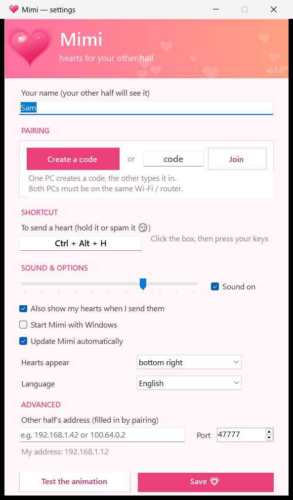
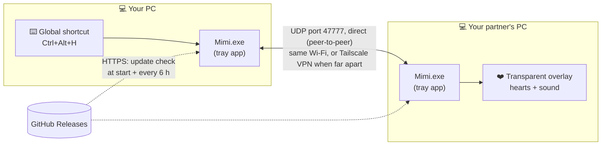
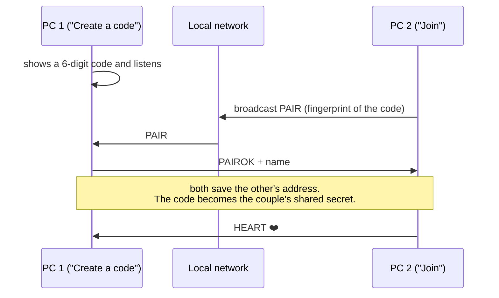
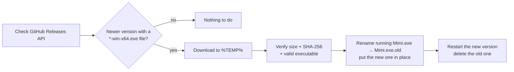

# Mimi 💗

**Send little hearts to your other half's screen with one key.**

You press a shortcut on your PC (by default **Ctrl + Alt + H**), and a stream of small animated hearts
floats up in the corner of your partner's screen, with a soft, cute sound, just like likes on a live stream.
The more you press, the more hearts. 💕

- Tiny: a single 150 KB file, nothing else to install
- No account, no server: the two PCs talk directly to each other
- Starts with Windows and updates itself
- Never slows your PC down, even while gaming
- English or French

<p align="center"></p>

---

## 1. Install it (on both PCs)

1. **Download** `Mimi-…-win-x64.exe` from the [latest release](https://github.com/axel-gilbert/mimi/releases/latest).
2. **Double-click** the file.
   - If a blue window says *"Windows protected your PC"*, click **More info**, then **Run anyway**.
     (This only appears because Mimi is a small free app that isn't signed by a company.)
3. Mimi asks *"Install Mimi on this PC?"*: click **Yes**.
4. If Windows asks for permission (network or *"Do you want to allow this app…"*), click **Yes / Allow**.
5. The Mimi window opens. Type **your name**.

Do the same on your partner's PC. ✅

> Mimi now lives near the clock, at the bottom right of the screen (a small heart icon).
> If you don't see it, click the little **^** arrow next to the clock.

## 2. Connect the two PCs (only once)

Both PCs must be **at the same place, on the same Wi-Fi / internet box** for this step.

| On PC 1 | On PC 2 |
|---|---|
| Click **Create a code**. A 6-digit code appears. | Type that code, then click **Join**. |

Hearts rain on both screens: you're connected! 💞
From now on, Mimi reconnects by itself every time the PCs are turned on.

## 3. Send hearts

- Press **Ctrl + Alt + H**. Press it again and again (or hold it) for a shower of hearts.
- The heart icon near the clock is **pink** when your partner is connected and **grey** when they're not.
- To change the shortcut, the sound, the corner where hearts appear or the language:
  click the heart icon to open the **settings**, change what you want and click **Save**.

## Questions

**My partner doesn't receive anything.**
Check that their heart icon is pink. If it's grey, their PC is off, Mimi is closed, or you're not on the same network
(see below).

**We don't live together / we're on different networks.**
Mimi connects the PCs directly, so they need to "see" each other. The easiest free way:
1. Install [Tailscale](https://tailscale.com/download) on both PCs and sign in with the same account.
2. In Tailscale, note the address of each PC (it looks like `100.x.y.z`).
3. In Mimi's settings, under **Advanced**, type the *other* PC's Tailscale address, on both PCs. Click **Save**.

**I don't see hearts during a game.**
Hearts are shown above everything, but games in *exclusive full screen* hide them. Use *borderless window* mode in the game's settings.

**How do updates work?**
Mimi checks for a new version when it starts and every 6 hours. If there is one, it downloads it, checks it,
installs it and restarts by itself. You'll see *"Mimi updated"*. You can turn this off in the settings,
or check by hand: right-click the heart icon, then **Check for updates**.

**How do I uninstall it?**
Right-click the heart icon, then **Uninstall…**, or use *Windows Settings → Apps*.

---

## How it works



- **No server.** The two Mimi apps send each other tiny UDP messages:
  `HEART` (one per key press) and `PING`/`PONG` every few seconds to know if the other one is online.
- **Private.** Each message carries a fingerprint (SHA-256) of your pairing code, never the code itself.
  Messages from other couples are ignored.
- **Light.** The overlay window is hidden when nothing moves (0 % CPU). While hearts fly,
  a small home-made renderer only redraws the area that changes (around 5 % of one CPU core during a big burst),
  and Mimi runs at low priority so your games and apps always come first.

### Pairing



If an address changes later (router restarted…), a PC that can't reach its partner broadcasts its `PING`
on the local network and the partner answers, so they find each other again automatically.

### Updates



---

## For developers

**Build** (needs the [.NET SDK](https://dotnet.microsoft.com/download) 8 or newer; the app targets .NET Framework 4.8, built into Windows 10/11):

```powershell
powershell -ExecutionPolicy Bypass -File build.ps1   # -> dist\Mimi.exe
```

**Publish a release** (the updater picks the highest version tag that has a `*-win-x64.exe` file):

1. Bump `<Version>` in `Mimi.csproj`, build, then copy `dist\Mimi.exe` to `Mimi-X.Y.Z-win-x64.exe`.
2. `git tag vX.Y.Z && git push --tags`
3. `gh release create vX.Y.Z Mimi-X.Y.Z-win-x64.exe`

**Project layout**

| File | Role |
|---|---|
| `src/Program.cs` | Entry point, command-line options, single instance |
| `src/MimiApp.cs` | Tray icon, hotkey, network, overlay, sounds and updates wired together |
| `src/Overlay.cs` | Transparent click-through window, heart stream animation (easing, sway, squash & stretch) |
| `src/Blitter.cs` | Fixed-point software renderer + dirty-tile tracking |
| `src/Art.cs` | Hearts drawn in code (gradient, highlights, glow) at several sizes |
| `src/SoundBank.cs` | Synthesized sounds (pentatonic "bloop", two-note chime, arpeggio) |
| `src/PeerLink.cs` | Peer-to-peer UDP, pairing by broadcast, presence, address tracking |
| `src/Updater.cs` | Self-update from GitHub Releases |
| `src/Installer.cs` | Self-install, start with Windows, Start menu, firewall rule, uninstall |
| `src/SettingsForm.cs` | Settings window |
| `src/Lang.cs` | English / French translations |

**Wire protocol** (UDP, port 47777): `MIMI|1|<tag>|<TYPE>|<name>|<instance>`, where `tag` is a SHA-256 fingerprint of the pairing code.

**Test on a single PC**

```powershell
.\Mimi.exe --portable --pair-host 123456      # profile "default", port 47777, Ctrl+Alt+H
.\Mimi.exe --profile B --pair-join 123456     # profile "B", port 47778, Ctrl+Alt+J
```

Each profile keeps its own settings in `%APPDATA%\Mimi\<profile>`.
Errors are logged to `%APPDATA%\Mimi\<profile>\errors.log`.
