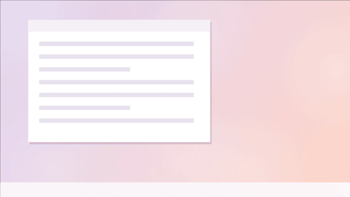

# Mimi 💗

**أرسل قلوبًا صغيرة إلى شاشة نصفك الآخر بضغطة مفتاح واحدة.**

Mimi تطبيق صغير ومجاني لنظام Windows. عند الضغط على الاختصار، تطفو قلوب صغيرة متحركة في زاوية شاشة شريكك، مع صوت لطيف. ويمكنك أيضًا إرسال قلب كبير أو رسالة قصيرة أو صورة أو GIF. بلا حساب وبلا خادم: يتحدث الكمبيوتران مباشرة مع بعضهما، وكل شيء مشفّر.

## التثبيت (على الكمبيوترين)

1. نزّل `Mimi-…-win-x64.exe` من [آخر إصدار](https://github.com/axel-gilbert/mimi/releases/latest).
2. انقر عليه مرتين. إذا ظهرت رسالة *«Windows حمى جهازك»*، انقر **مزيد من المعلومات** ثم **تشغيل على أي حال**.
3. انقر **نعم** للتثبيت، ثم **نعم / سماح** إذا طلب Windows الوصول إلى الشبكة.
4. اكتب اسمك. أصبح Mimi الآن بجانب الساعة (أيقونة قلب صغيرة) ويبدأ مع Windows.

## ربط الكمبيوترين (مرة واحدة فقط)

يجب أن يكون الكمبيوتران على نفس شبكة Wi-Fi في هذه الخطوة.

1. على الكمبيوتر الأول، انقر **إنشاء رمز**: سيظهر رمز من 6 أرقام.
2. على الكمبيوتر الثاني، اكتب الرمز وانقر **انضمام**. تم 💞

## طريقة الاستخدام

- **Ctrl + Alt + H**: إرسال قلب. أبقِ المفاتيح مضغوطة للحصول على قلب كبير يكبر.
- **Ctrl + Alt + M**: كتابة رسالة أو إرسال صورة أو GIF، وتظهر في وسط الشاشة.
- اضغط في نفس لحظة شريكك لتحصلا على مفاجأة.
- انقر بزر الفأرة الأيمن على أيقونة القلب لتفعيل **عدم الإزعاج** (من 10 دقائق إلى 24 ساعة، أو حتى توقفه).
- يحدّث Mimi نفسه تلقائيًا.

مزيد من التفاصيل (بالإنجليزية): [README](../../README.md)

